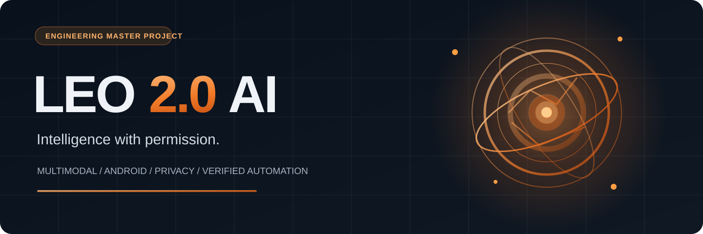

# LEO 2.0 AI

### Your intelligent assistant. Your permissions. Your control.

**A research-backed engineering workspace for building a multimodal, privacy-first personal AI assistant across web and Android.**

[**Explore the architecture**](docs/ARCHITECTURE.md) · [**Read the roadmap**](docs/ROADMAP.md) · [**See the workflows**](docs/WORKFLOWS.md) · [**Security model**](SECURITY.md)

---

## What is LEO 2.0?

LEO 2.0 is an **in-development** hybrid AI assistant project designed to combine:

- **Conversational intelligence:** streaming chat, grounded research, citations and approved-document Q&A.
- **Multimodal interaction:** planned voice, images, video tasks and Telugu-English code-mixed conversations.
- **User-authorized Android features:** selected-file access, on-demand screen sharing, app launch intents and an optional floating assistant.
- **Safe task planning:** bounded plans, policy checks on every tool call, approval screens, receipts and a stop control.
- **Responsible data architecture:** per-user isolation, versioned consent, portable memory, encryption where appropriate and clear data-deletion controls.
- **Practical API orchestration:** a small number of **verified, owner-authorized** providers before expanding to a wider resource catalog.

> [!IMPORTANT]
> **This is an engineering specification and development workspace, not a shipped AI app.** Listed features are planned unless a linked implementation and executed test demonstrate otherwise. A UI mockup is not a live service; a provider directory is not a collection of working API keys. LEO will not promise unrestricted access to a phone or other applications.

## Core product layers

| Layer | Planned responsibility | Current repo status |
| --- | --- | --- |
| Web dashboard | Chat, sources, approved files, model status, settings, privacy and usage | Specification |
| Native Android client | Kotlin/Compose shell, user-triggered microphone, overlay, Android file picker | Specification |
| API gateway | Auth, usage limits, schemas, secure provider secrets, streamed responses | Contract/design |
| Agent orchestrator | Bounded planning, tool routing, policy decisions, verification | Contract/design |
| Data + knowledge | PostgreSQL, per-user records, opt-in memory and cited RAG | Schema proposal |
| Quality + observability | CI, tests, policy fixtures, privacy review and release gates | Repository checks |

## Explore the engineering package

| Topic | Documentation |
| --- | --- |
| Product vision, boundaries and key decisions | [Product requirements](docs/PRODUCT_REQUIREMENTS.md) |
| Modular system and trust boundaries | [Architecture](docs/ARCHITECTURE.md) |
| Interfaces, screen map and visual system | [UI / UX](docs/UI_UX.md) |
| Agent policy and Android permissions | [Permissions and autonomy](docs/PERMISSIONS.md) |
| Tool and provider catalog with verification rules | [API strategy](docs/PROVIDERS.md) |
| Data model, storage, RAG and memory | [Data architecture](docs/DATA.md) |
| Voice, media, image/video and accessibility | [Multimodal features](docs/MULTIMODAL.md) |
| Event lifecycle and CI architecture | [Workflows](docs/WORKFLOWS.md) |
| Project stages, dependencies and milestones | [Roadmap](docs/ROADMAP.md) |
| Test cases and production gates | [Testing plan](docs/TEST_PLAN.md) |
| Uploaded document inventory and provenance | [Source register](docs/SOURCES.md) |
| Build-ready prompt adapted from supplied source | [Developer instruction](prompts/LEO_2_BUILD_INSTRUCTION.md) |

### Planned architecture

~~~mermaid
flowchart TB
  U[User on Web or Android] --> G[Secure API Gateway]
  G --> O[LEO Orchestrator]
  O --> P{Deterministic Policy Gate}
  P -->|Authorized| T[Typed Tools + Model Broker]
  P -->|Needs approval| A[Consent and Approval UI]
  P -->|Denied| D[Explain and Stop]
  A -->|Approved scope| T
  T --> V[Verify Results and Audit]
  V --> U
  G --> DB[(Per-user Data + Memory)]
~~~

## First working milestone

The first implementation milestone is deliberately narrow: **authenticate → request a streamed response through a server-held provider key → save permitted conversation state → return a verifiable result with clear error handling**.

Only after this vertical slice passes automated and human testing should the project add source-backed file Q&A, voice, floating overlay, and bounded tool use.

## Working with the repository

This repository currently organizes source-informed specifications and quality checks. **No backend, Android APK, API integration, website deployment, or production AI endpoint is claimed as operational.**

1. Read [the architecture](docs/ARCHITECTURE.md) and [the implementation phases](docs/ROADMAP.md).
2. Follow [contributing rules](CONTRIBUTING.md) and [security expectations](SECURITY.md).
3. For each proposed feature, include implementation, tests, evidence, and a status update. Keep credentials out of source control.
4. Run the repository's document/schema checks through GitHub Actions before merging.

## Source provenance

The repository documentation is **derived and organized** from four uploaded LEO 2.0 sources, including the 311-page master engineering PDF, a Word build guide and a copy-ready development prompt. See [the provenance register](docs/SOURCES.md) for file names, hashes, evidence levels and source-to-specification mapping.

The original binary PDF/DOCX and embedded ZIP attachments are **not represented as uploaded to this repository**. Unverified credentials, demo tokens and third-party content are intentionally excluded.

## Author & related projects

**Sandu Venkata Siva Ramakrishna** · [GitHub profile](https://github.com/svsramakrishnanaidu-rgb)

- [LEO.AI — civic issue reporting prototype](https://github.com/svsramakrishnanaidu-rgb/leo-ai) — a separate project; **not** the LEO 2.0 product.
- [FinTrack — personal Flutter expense tracker](https://github.com/svsramakrishnanaidu-rgb/fin-tracker)
- [BSR Learning — project portfolio](https://github.com/svsramakrishnanaidu-rgb/bsr-learning)

LEO 2.0 AI · User-authorized · Privacy-first · Testable · Engineering specification, November 2026

